<a href="https://r-m77.github.io/R-M77/?play=banner"><picture><source media="(prefers-reduced-motion: reduce)" srcset="https://raw.githubusercontent.com/R-M77/R-M77/main/assets/hello-still.png"></picture></a>

# Embedded vision and ML systems

I build computer vision software for automotive edge processors. I’ve written image-correction libraries in C and tested MobileNet on custom silicon. I’m interested in embedded ML roles where accuracy, latency, and memory use shape what runs on the device.

[Play profile animations](https://r-m77.github.io/R-M77/?play=banner) · [Résumé](https://github.com/R-M77/Resume/blob/main/Resume_Armin_Eshaghi.pdf) · [Publications](https://github.com/R-M77/Resume/blob/main/Publications.md) · [LinkedIn](https://www.linkedin.com/in/armineshaghi)

## Vision-guided microsurgery

For my M.A.Sc. at the University of Toronto, I developed methods to locate cell features in 3D and steer a micromanipulator with visual feedback. Each new microscope frame lets the controller check the tool’s position and correct its motion.

<a href="https://r-m77.github.io/R-M77/?play=control"><picture><source media="(max-width: 550px) and (prefers-reduced-motion: reduce)" srcset="https://raw.githubusercontent.com/R-M77/R-M77/main/assets/figures/control-loop-compact-still.svg"><source media="(prefers-reduced-motion: reduce)" srcset="https://raw.githubusercontent.com/R-M77/R-M77/main/assets/figures/control-loop-still.svg"><source media="(max-width: 550px)" srcset="https://raw.githubusercontent.com/R-M77/R-M77/main/assets/figures/control-loop-compact.svg"></picture></a>

[Watch the 6-second clip](https://r-m77.github.io/R-M77/?play=clip) · [Read my first-author paper](https://www.inderscience.com/info/inarticle.php?artid=118413) · [Browse the experiments](https://github.com/R-M77/Automated_Microsurgery)

## MLIR Cost Model Lab · Saving a tensor round trip

I built a Python cost model to trace where tensor programs move data. In this example, ReLU consumes eight values from a bias addition. Fusing the two operations eliminates a write and a read of those values, cutting **modeled memory traffic by 25.8%** for the same 64 scalar operations.

<a href="https://r-m77.github.io/R-M77/?play=fusion"><picture><source media="(max-width: 550px) and (prefers-reduced-motion: reduce)" srcset="https://raw.githubusercontent.com/R-M77/R-M77/ffacf42ffdae630c3e8061a1d3ea63cb0231bb8d/assets/figures/tensor-fusion-compact-still.svg"><source media="(prefers-reduced-motion: reduce)" srcset="https://raw.githubusercontent.com/R-M77/R-M77/ffacf42ffdae630c3e8061a1d3ea63cb0231bb8d/assets/figures/tensor-fusion-still.svg"><source media="(max-width: 550px)" srcset="https://raw.githubusercontent.com/R-M77/R-M77/ffacf42ffdae630c3e8061a1d3ea63cb0231bb8d/assets/figures/tensor-fusion-compact.svg"></picture></a>

[Play the fusion animation](https://r-m77.github.io/R-M77/?play=fusion) · [Run the example](https://github.com/R-M77/mlir-cost-model-lab#run-a-reproducible-example) · [Walk through the byte counts](https://gist.github.com/R-M77/d473a24becf85af5ce83941cb51230c2)

## Gait capture for fall detection in an elder care home

At Toronto Rehab (UHN), I built a gait capture system and implemented it at an elder care home for fall-detection research. I used hardware triggers to synchronize camera frames with motion-sensor readings, then analyzed the recordings with OpenCV.

[Play the illustrated stride](https://r-m77.github.io/R-M77/?play=gait) · [Toronto Rehab experience in my résumé](https://github.com/R-M77/Resume/blob/main/Resume_Armin_Eshaghi.pdf)

<a href="https://r-m77.github.io/R-M77/?play=gait"><picture><source media="(max-width: 550px) and (prefers-reduced-motion: reduce)" srcset="https://raw.githubusercontent.com/R-M77/R-M77/cd5552cf2a05dbf1cc6c1d2500a9d9362c71f230/assets/figures/gait-capture-compact-still.svg"><source media="(prefers-reduced-motion: reduce)" srcset="https://raw.githubusercontent.com/R-M77/R-M77/cd5552cf2a05dbf1cc6c1d2500a9d9362c71f230/assets/figures/gait-capture-still.svg"><source media="(max-width: 550px)" srcset="https://raw.githubusercontent.com/R-M77/R-M77/cd5552cf2a05dbf1cc6c1d2500a9d9362c71f230/assets/figures/gait-capture-compact.svg"></picture></a>

## JetsonCast for older TVs

My TV had HDMI but no YouTube app, so I turned an 8 GB Jetson Orin Nano into a receiver. VacuumTube handles playback. I built the Linux setup and audio routing, then tested casting from my phone with video and sound over the Jetson’s DisplayPort-to-HDMI connection.

<a href="https://r-m77.github.io/R-M77/?play=jetson"><picture><source media="(max-width: 550px) and (prefers-reduced-motion: reduce)" srcset="https://raw.githubusercontent.com/R-M77/R-M77/main/assets/figures/jetsoncast-compact-still.svg"><source media="(prefers-reduced-motion: reduce)" srcset="https://raw.githubusercontent.com/R-M77/R-M77/main/assets/figures/jetsoncast-still.svg"><source media="(max-width: 550px)" srcset="https://raw.githubusercontent.com/R-M77/R-M77/eccb87a8998a4218eb37926b20db4af782704e03/assets/figures/jetsoncast-compact.svg"></picture></a>

[Watch the 27-second demo](https://r-m77.github.io/R-M77/?play=jetson) · [Set up a receiver](https://github.com/R-M77/JetsonCast#quick-start)

### Other engineering work

- [RFID reader integration in C++](https://github.com/R-M77/AMBIENT_video_capture/blob/dev/G_test.cpp) — USB reader discovery, tag inventory, and timestamped CSV logging.
- [OpenClaw scheduling prototype](https://github.com/R-M77/openclaw/tree/feat/main-session-agent-turn) — a TypeScript change that lets a scheduled job reuse the main session’s conversation context.
