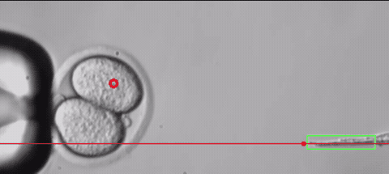

  
  
  
  
  <a href="https://raw.githubusercontent.com/R-M77/R-M77/main/assets/hello.gif">View header animation ↗</a> · <a href="https://github.com/R-M77/R-M77/blob/main/assets/hello-still.png">Still image</a>

I'm **Armin Eshaghi**. I build computer vision software for automotive edge processors. I've written reusable C libraries for image correction and tested MobileNet on custom silicon to check the accuracy and performance of on-chip inference.

[Watch a robot track a cell](#-vision-guided-microsurgery) · [Cast YouTube to an old TV](#-jetsoncast) · [Inspect a tensor fusion](#mlir-cost-model-lab)

## 🔬 Vision-guided microsurgery

A cell moves under the microscope. How does the robot keep its tool on target? During my **M.A.Sc. at the University of Toronto**, I developed image-processing methods to locate features in 3D and a controller that used visual feedback to guide the micromanipulators. In the clip, watch the tracking overlays as the tools approach the cell.

[Supplementary Video 1 (MP4)](https://raw.githubusercontent.com/R-M77/Automated_Microsurgery/main/Supplementary%20Video%201.mp4) · [First-author paper](https://www.inderscience.com/info/inarticle.php?artid=118413) · [All four experiments](https://github.com/R-M77/Automated_Microsurgery) · [Still frame](assets/microsurgery-still.png)

## 📺 JetsonCast

My old TV had an HDMI input and no YouTube app. I plugged in a **Jetson Orin Nano** so I could pick a video on my phone and play it on the TV. VacuumTube provides YouTube playback, casting discovery and ad blocking. I built the Linux setup, TV audio routing and idle screensavers around it. Jet, the little lynx in the demo, turns up if you enable fun mode.

[Get JetsonCast](https://github.com/R-M77/JetsonCast) · [Watch the animated demo](https://raw.githubusercontent.com/R-M77/JetsonCast/main/assets/previews/demo.gif) · [Landscape MP4](https://raw.githubusercontent.com/R-M77/JetsonCast/main/assets/previews/demo-landscape.mp4) · [Vertical clip (MP4)](https://raw.githubusercontent.com/R-M77/JetsonCast/main/assets/previews/demo-vertical.mp4) · [Device guides](https://github.com/R-M77/JetsonCast/tree/main/devices)

## MLIR Cost Model Lab

How much memory traffic does fusing two operations save? I built a Python tool to trace tensor shapes, count reads and writes, and compare fusion plans. In one example, a matrix multiply feeds a bias addition and then ReLU.

| Model result | Separate operations | Fuse bias and ReLU |
| --- | ---: | ---: |
| Logical bytes read and written | 248 | 184 |
| Scalar operations | 64 | 64 |

Fusion skips one intermediate write and read. These are static estimates from the graph. The Python example produces both reports, so you can change the shapes and compare them yourself.

[Run the example](https://github.com/R-M77/mlir-cost-model-lab#run-a-reproducible-example) · [Inspect the input graph](https://github.com/R-M77/mlir-cost-model-lab/blob/main/examples/matmul_bias_relu.json) · [Model assumptions](https://github.com/R-M77/mlir-cost-model-lab/blob/main/docs/reference.md)

## Other engineering work

- **Context-aware scheduling in TypeScript.** I prototyped a way for an OpenClaw scheduled job to reuse the main session’s conversation context, with validation at the CLI and service boundaries. [Implementation](https://github.com/R-M77/openclaw/tree/feat/main-session-agent-turn) · [Upstream proposal](https://github.com/openclaw/openclaw/pull/31827)
- **RFID reader integration in C++.** I used the FEIG SDK to discover USB readers, inventory tags and write timestamped identifiers to CSV for downstream analysis. [Reader prototype](https://github.com/R-M77/AMBIENT_video_capture/blob/dev/G_test.cpp)

**Tools I work with** · C and C++ for embedded software, Python and OpenCV for vision, PyTorch and TensorFlow for ML, and Linux for integration.

I’m especially interested in embedded vision and ML systems roles where I can work on inference, memory use and latency on real hardware.

[Résumé](https://github.com/R-M77/Resume/blob/main/Resume_Armin_Eshaghi.pdf) · [LinkedIn](https://www.linkedin.com/in/armineshaghi) · [Publications](https://github.com/R-M77/Resume/blob/main/Publications.md)
