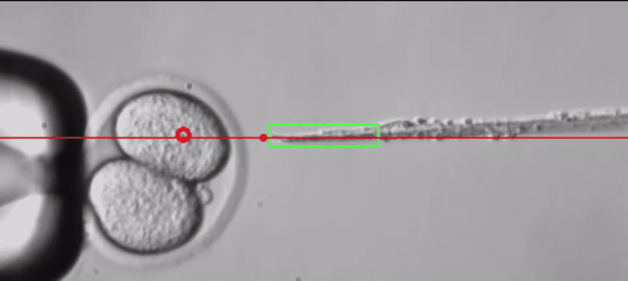

# Embedded vision and ML systems

I build computer vision software for automotive edge processors. I’ve written C libraries for image correction and tested MobileNet on custom silicon to measure inference accuracy and performance.

[Read my résumé](https://github.com/R-M77/Resume/blob/main/Resume_Armin_Eshaghi.pdf)

## Vision-guided microsurgery

During my M.A.Sc. at the University of Toronto, I developed image-processing methods to locate features in 3D and a feedback controller to guide the robot’s tools. In the microscope footage, the green box tracks the tool tip as it approaches the cell.

[Watch the six-second tracking clip](https://github.com/R-M77/R-M77/blob/main/assets/microsurgery.gif) · [Read the research paper](https://www.inderscience.com/info/inarticle.php?artid=118413)

## Selected engineering projects

### Estimating tensor memory traffic

I built **MLIR Cost Model Lab**, a Python tool for comparing tensor fusion plans. In the included example, fusing bias addition with ReLU eliminates an intermediate write and read. Estimated memory traffic drops from **248 to 184 bytes** for the same 64 scalar operations.

[Run the fusion example](https://github.com/R-M77/mlir-cost-model-lab#run-a-reproducible-example)

### Bringing YouTube casting to an older TV

My TV had HDMI but no YouTube app, so I built **JetsonCast** around a Jetson Orin Nano. VacuumTube handles playback and casting. I built the Linux setup, routed audio to the TV, and added idle screensavers.

[Explore JetsonCast and its setup guide](https://github.com/R-M77/JetsonCast#quick-start)

## More of my work

- [RFID data capture in C++](https://github.com/R-M77/AMBIENT_video_capture/blob/dev/G_test.cpp) — I used the FEIG SDK to discover USB readers, inventory tags, and log timestamped identifiers to CSV.
- [Context-aware scheduling in TypeScript](https://github.com/R-M77/openclaw/tree/feat/main-session-agent-turn) — I prototyped a way for scheduled OpenClaw jobs to reuse the main session’s conversation context.
- [Research publications](https://github.com/R-M77/Resume/blob/main/Publications.md) — my thesis and papers on vision-based control for single-cell surgery.

I’m interested in embedded vision and ML systems roles focused on inference latency and memory use on real hardware. [Connect with me on LinkedIn](https://www.linkedin.com/in/armineshaghi).
